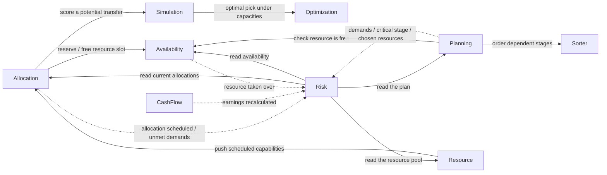

# Context Map — smartschedule

A resource-scheduling and project-management domain. The company runs many
projects in parallel. Each project is broken into stages with dependencies and a
set of **demands** — the capabilities (skills, equipment) it needs and the time
windows it needs them in. Resources (employees, devices) each offer a set of
capabilities and have limited availability. The business decides **which resource
is committed to which demand, in which time slot**, tries to do so optimally,
simulates the profitability of portfolio decisions, tracks each project's earnings
and cost, and watches every project for risk.

## Bounded contexts

| Context | Domain classification | Class of problem | Responsibility |
|---|---|---|---|
| **Allocation** | supporting | Contention (orchestration; locking delegated to Availability) | Commit capabilities to project demands per time slot, and track which demands are still unmet. Owns the allocation aggregate and the source of truth for `Demands`/`Allocations`; contains capability scheduling. |
| **Risk** | core | Integration | Decide whether a project is at risk and what to do about it. A saga driven entirely by events from the other contexts. |
| **Availability** | generic | Contention | Track whether a resource is free during a slot and resolve competition for it; guarded with optimistic locking. |
| **Optimization** | core-generic | Transformation | Compute the optimal pick under given weights and capacities (knapsack-shaped). A pure calculation with no dependencies. |
| **Simulation** | core-generic | Transformation | Answer what-if profitability questions — profit after buying a new capability, the optimal setup. |
| **Sorter** | core-generic | Transformation | Produce a valid ordering / parallelization of dependent stages (dependency graph). |
| **Planning** | supporting | CRUD | Define what a project must deliver — its stages, dependencies, and chosen resources. |
| **Resource** | supporting | CRUD | Register which employees and devices exist and what each can do. |
| **CashFlow** | supporting | CRUD | Record what a project earns and what it costs. |

`Capability` (published language), `TimeSlot` (shared value object), and the
event-publishing channel are shared language, not modules.

## Relations

Direction is **downstream → upstream** (the dependent side named first). Each row
says what the dependency actually carries between the two modules.

| # | Dependency | What it needs from the other module | Mechanism | Pattern |
|---|---|---|---|---|
| R1 | Allocation → Availability | When a capability is committed to a project, Allocation reserves that resource's slot — and frees it when the allocation is undone. | synchronous calls | Customer-Supplier (sync) |
| R2 | Planning → Availability | Before committing to chosen resources, Planning checks they are actually free in the needed windows. | synchronous query | Customer-Supplier (sync) |
| R3 | Resource → Allocation | When an employee's capabilities are scheduled, Resource pushes those capabilities into Allocation so they can be allocated. | synchronous call | Customer-Supplier (sync) |
| R4 | Allocation → Simulation | To weigh moving a resource between projects, Allocation asks Simulation to score the profitability of the potential transfer. | synchronous call | Customer-Supplier (sync) |
| R5 | Simulation → Optimization | Simulation hands candidate setups to Optimization and gets back the best pick under the given capacities. | synchronous call | Open-Host Service (Optimization publishes a clean calculation interface) |
| R6 | Planning → Sorter | Planning translates its stages into graph nodes and asks Sorter for a valid dependency-respecting ordering / parallelization. | synchronous call | Anticorruption Layer (Planning) + Open-Host Service (Sorter) |
| R7 | Allocation → Risk | Risk learns that a project's allocation was scheduled and which demands remain unmet — its main signal of delivery risk. | published events: Project Allocation Scheduled, Not Satisfied Demands | Published events (async) |
| R8 | CashFlow → Risk | Risk learns when a project's earnings were recalculated, to weigh whether the project is still worth saving. | published event: Earnings Recalculated | Published events (async) |
| R9 | Availability → Risk | Risk learns when a resource was taken over by another project, so it can react to a resource being lost. | published event: Resource Taken Over | Published events (async) |
| R10 | Planning → Risk | Risk learns what capabilities a project demands, when a critical stage is planned, and which resources were chosen — the things it must verify. | published events: Capabilities Demanded, Critical Stage Planned, Needed Resources Chosen | Published events (async) |
| R11–R14 | Risk → Allocation / Availability / Planning / Resource | To assess a project, Risk reads back the current allocations, availability, plan, and resource pool. | synchronous queries | Customer-Supplier (sync) |
| R15 | Allocation → legacy resource feed | Capability scheduling ingests "employee created" notifications from a legacy system and translates them into its own model. | translating inbound message handler | Anticorruption Layer |
| R16 | Planning, Simulation → Allocation | Both read `Demands` and `Allocations` whose definition and source of truth live in Allocation. | shared types | Shared Kernel |
| R17 | every context → shared language | All contexts speak `Capability` (and `TimeSlot`) when describing what a resource offers and when. | direct use of the shared concept | Published Language |

